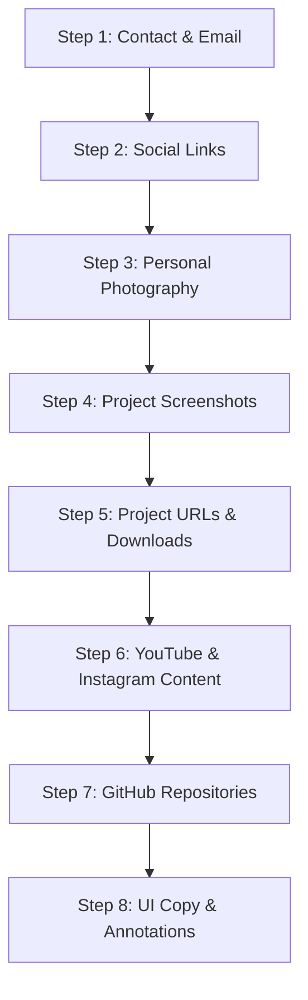

# Portfolio Asset Structure and Complete Site Audit — Irshad Akhtar

> **Audit Date:** October 26, 2026  
> **Auditor:** Antigravity Agentic Assistant  
> **Scope:** Full repository inspection of codebase transferred from Lovable to Antigravity  
> **Strict Policy:** Read-Only Audit. No application source code, configuration, components, or styling were modified. Exactly one file created (`PORTFOLIO_ASSET_STRUCTURE_AND_AUDIT.md`).

---

## 1. Project Overview and Audit Scope

### 1.1 Technical Stack & Framework Architecture
This project is a high-performance web portfolio built using modern, cutting-edge TypeScript and React tooling:
- **Framework & Meta-Framework:** [TanStack Start](https://tanstack.com/start/latest) (version `1.168.60`) with [TanStack React Router](https://tanstack.com/router/latest) (`1.170.41`) and [TanStack Query](https://tanstack.com/query/latest) (`5.101.1`).
- **Server Engine & Bundler:** [Nitro](https://nitro.unjs.io/) (`3.0.260603-beta`) running via [Vite](https://vitejs.dev/) (`8.1.5`) with [@lovable.dev/vite-tanstack-config](https://lovable.dev) (`2.26.5`).
- **Runtime & UI Library:** [React 19](https://react.dev/) (`19.2.0`), React DOM (`19.2.0`).
- **Styling Architecture:** [Tailwind CSS v4](https://tailwindcss.com/) (`4.2.1`) using modern `@theme inline` and OKLCH color spaces, alongside `@tailwindcss/vite` (`4.2.1`), `tw-animate-css` (`1.3.4`), and custom paper-texture utilities.
- **Component Primitives:** Complete [Radix UI](https://www.radix-ui.com/) unstyled primitive suite (`@radix-ui/react-*`), [Lucide React](https://lucide.dev/) icons (`0.575.0`), and [Embla Carousel React](https://www.embla-carousel.com/) (`8.6.0`).
- **Forms & Validation:** [React Hook Form](https://react-hook-form.com/) (`7.71.2`) with [Zod](https://zod.dev/) (`3.25.76`) and `@hookform/resolvers` (`5.2.2`).
- **Testing:** [Vitest](https://vitest.dev/) (`4.1.10`) with [Testing Library](https://testing-library.com/) (`@testing-library/react` `16.0.0`, `@testing-library/jest-dom` `6.6.0`) and `jsdom` (`20.0.3`).

### 1.2 Design Language & Aesthetic Identity
The portfolio utilizes an **editorial scrapbook & paper journal aesthetic** paired with sleek dark-mode panels:
- **Color Palette (OKLCH):**
  - `--night` (`oklch(0.14 0.008 150)`): Deep forest dark background.
  - `--charcoal` (`oklch(0.18 0.01 140)`): Elevated dark container surface.
  - `--forest` (`oklch(0.32 0.04 150)`) & `--moss` (`oklch(0.47 0.04 135)`): Earthy green accents.
  - `--paper` (`oklch(0.93 0.025 85)`) & `--paper-deep` (`oklch(0.9 0.027 85)`): Warm cream paper surfaces with fractal SVG grain textures.
  - `--beige` (`oklch(0.83 0.04 82)`) & `--gold` (`oklch(0.74 0.07 75)`): Antique warm highlights.
  - `--ink` (`oklch(0.27 0.01 95)`) & `--ink-muted` (`oklch(0.45 0.02 85)`): Rich dark type colors.
- **Typography:**
  - Display: `Cormorant Garamond` (Google Fonts, serif, elegant editorial headers).
  - Handwriting / Script: `Caveat` (Google Fonts, cursive annotations and personal handwritten notes).
  - Body & UI: `Inter` (Google Fonts, neutral sans-serif body).
- **Physical & Depth Affordances:**
  - `.torn-top`, `.torn-bottom`, `.torn-both`: Irregular polygon clip-paths simulating hand-torn notebook paper.
  - `.tape`: Translucent semi-rotated masking tape pinned to cards and photos.
  - `.photo-frame`: Classic Polaroid-style white border with drop shadow.
  - `.depth-card`: Interactive pointer-driven 3D tilt calculated on `requestAnimationFrame` with fine mouse detection, respecting `prefers-reduced-motion`.
  - `.hero-parallax`: Multi-layer perspective parallax in the hero banner.

### 1.3 Audit Scope & Methodology
The audit entailed a strict read-only examination of:
1. Every file, directory, and asset in the repository.
2. All 12 route endpoints and views in TanStack Router.
3. All 8 featured projects across Android, Web, and Browser Extensions.
4. All 24 screenshot display slots (currently rendered as CSS mockups).
5. All 4 existing image assets in `src/assets/` and public static files.
6. All external links, actions, buttons, and stateful toggles.
7. The Android APK and Chromium Browser Extension 5-step installation guides.
8. The Contact page form validation and dispatch mechanism.
9. Every single placeholder, TODO, demo value, and unconfigured endpoint.

---

## 2. Actual Existing Folder Structure

### 2.1 Workspace Root Tree (Actual Verified Files)
Below is the verified tree of all directories and files existing within `d:\irshad portfolios`:

```
d:\irshad portfolios\
├── .gitignore
├── .lovable\
│   └── project.json
├── .prettierignore
├── .prettierrc
├── AGENTS.md
├── bun.lock
├── bunfig.toml
├── components.json
├── eslint.config.js
├── package.json
├── PORTFOLIO_PLACEHOLDER_HANDOFF.md
├── README.md
├── tsconfig.json
├── vite.config.ts
├── vitest.config.ts
├── public\
│   ├── favicon.ico                         (20,373 bytes - Lovable default favicon)
│   └── robots.txt                          (160 bytes - User-agent allow, Disallow /api/)
└── src\
    ├── router.tsx                          (Router initialization with QueryClient)
    ├── routeTree.gen.ts                    (Auto-generated TanStack route tree)
    ├── server.ts                           (Server SSR entry with error boundary)
    ├── start.ts                            (TanStack Start instance with CSRF middleware)
    ├── styles.css                          (Tailwind v4 theme, paper utilities, animations)
    ├── assets\                             (Atmospheric stock photos used as placeholders)
    │   ├── city-night.jpg                  (139,640 bytes - Rainy city night scene)
    │   ├── hero-workspace.jpg              (225,014 bytes - Desk setup at sunset)
    │   ├── mountains.jpg                   (104,969 bytes - Mountain landscape at dusk)
    │   └── restaurant.jpg                  (130,216 bytes - Candlelit dining table)
    ├── components\
    │   ├── site\                           (Portfolio custom components)
    │   │   ├── ActionLink.tsx              (btn helper, ExternalAction [soon badge], ProjectLink)
    │   │   ├── cards.tsx                   (ProjectCard, AppCard, ExtensionCard, WebsiteCard)
    │   │   ├── decor.tsx                   (Star, HandwrittenAnnotation, SectionLabel, PinnedPhoto, PageIntro)
    │   │   ├── Gallery.tsx                 (ScreenshotGallery, ScreenshotLightbox with Dialog)
    │   │   ├── misc.tsx                    (Breadcrumbs, TechStackGrid, SocialRow, VideoCard, ContactForm, EmptyState)
    │   │   ├── Mockup.tsx                  (ProjectIcon monogram, ScreenMockup, CSS-drawn screens)
    │   │   ├── SetupGuide.tsx              (5-step setup guides for APKs & Extensions)
    │   │   ├── SiteFooter.tsx              (Global footer with copyright, nav, social row)
    │   │   └── SiteHeader.tsx              (Global sticky header with mobile drawer)
    │   └── ui\                             (46 Shadcn / Radix UI primitive wrappers)
    │       ├── accordion.tsx, alert-dialog.tsx, alert.tsx, aspect-ratio.tsx, avatar.tsx,
    │       ├── badge.tsx, breadcrumb.tsx, button.tsx, calendar.tsx, card.tsx,
    │       ├── carousel.tsx, chart.tsx, checkbox.tsx, collapsible.tsx, command.tsx,
    │       ├── context-menu.tsx, dialog.tsx, drawer.tsx, dropdown-menu.tsx, form.tsx,
    │       ├── hover-card.tsx, input-otp.tsx, input.tsx, label.tsx, menubar.tsx,
    │       ├── navigation-menu.tsx, pagination.tsx, popover.tsx, progress.tsx, radio-group.tsx,
    │       ├── resizable.tsx, scroll-area.tsx, select.tsx, separator.tsx, sheet.tsx,
    │       ├── sidebar.tsx, skeleton.tsx, slider.tsx, sonner.tsx, switch.tsx,
    │       ├── table.tsx, tabs.tsx, textarea.tsx, toggle-group.tsx, toggle.tsx, tooltip.tsx
    ├── data\                               (Single Source of Truth typed data files)
    │   ├── media.ts                        (Imports 4 images, defines videos, instaPosts, repositories)
    │   ├── navigation.ts                   (mainNav [9 routes], footerNav [9 routes + GitHub])
    │   ├── profile.ts                      (Irshad Akhtar profile, education, location, email=null)
    │   ├── projects.ts                     (8 typed projects with 3 screenshots each, all URLs null)
    │   ├── socialLinks.ts                  (YouTube, Instagram, GitHub, Email records)
    │   └── techStack.ts                    (45 technologies across 5 categorized groups)
    ├── hooks\
    │   ├── use-depth.ts                    (useTilt, useParallax for interactive mouse depth)
    │   └── use-mobile.tsx                  (useIsMobile media query hook)
    ├── lib\
    │   ├── error-capture.ts                (Global error interception for server SSR)
    │   ├── error-page.ts                   (Fallback HTML error template)
    │   ├── lovable-error-reporting.ts      (Error telemetry reporting bridge)
    │   └── utils.ts                        (cn helper: clsx + tailwind-merge)
    ├── routes\
    │   ├── __root.tsx                      (Root HTML shell, fonts, favicon link, header/footer, 404, error boundary)
    │   ├── about.tsx                       (About route: bio, education, journey, full tech stack)
    │   ├── apps.tsx                        (Apps route: 3 Android apps showcase with galleries)
    │   ├── contact.tsx                     (Contact route: social cards + contact form)
    │   ├── extensions.tsx                  (Extensions route: 3 browser extensions + guide links)
    │   ├── github.tsx                      (GitHub route: developer terminal card + repositories)
    │   ├── index.tsx                       (Homepage: hero, featured switcher, quick links, bands)
    │   ├── instagram.tsx                   (Instagram route: profile card + photo grid)
    │   ├── projects.$slug.tsx              (Dynamic detail route: dynamic header, gallery, guide, notes)
    │   ├── projects.index.tsx              (Projects index: filter by category, search by query)
    │   ├── README.md                       (TanStack Start routing guide)
    │   ├── websites.tsx                    (Websites route: Omni Web and Brown Oak showcase)
    │   └── youtube.tsx                     (YouTube route: channel header, video cards, featured projects)
    └── test\
        ├── app-routing.test.tsx            (Router match tests)
        └── setup.ts                        (Vitest matchers setup)
```

### 2.2 Distinguishing Existing Files vs Missing/Recommended Directories

| Path | Status | Purpose / Notes |
|---|---|---|
| `public/favicon.ico` | **EXISTS** | Standard generic template favicon. Needs replacement with Irshad's personal monogram/brand. |
| `public/robots.txt` | **EXISTS** | Valid production robots.txt file. |
| `public/images/` | **DOES NOT EXIST** | Recommended asset directory for static WebP imagery. |
| `public/downloads/` | **DOES NOT EXIST** | Optional directory if host-serving APKs/ZIPs directly instead of cloud storage. |
| `src/assets/` | **EXISTS** | Contains 4 stock JPGs (`city-night.jpg`, `hero-workspace.jpg`, `mountains.jpg`, `restaurant.jpg`). |
| `src/assets/projects/` | **DOES NOT EXIST** | Recommended if bundling screenshots through Vite asset pipeline instead of `public/`. |
| `src/assets/profile/` | **DOES NOT EXIST** | Recommended if storing portrait photos in the bundled module tree. |

---

## 3. Recommended Future Asset Folder Structure

To support all 8 projects, real personal photos, video thumbnails, Instagram previews, and downloads cleanly, two viable integration patterns exist. We recommend **Option A (`public/images/`)** for standard static asset serving without bundling overhead, while retaining compatibility with Option B (`src/assets/`).

### 3.1 Recommended Static Public Structure (`public/images/`)

```
public/
├── favicon.ico                             <- Personal brand icon (32x32 / 48x48 .ico)
├── icon.svg                                <- High-res vector favicon for modern browsers
├── apple-touch-icon.png                    <- 180x180 PNG for mobile bookmarks
├── og-image.jpg                            <- 1200x630 OpenGraph / Twitter social preview
├── robots.txt                              <- Existing robots definition
└── images/
    ├── hero/
    │   └── hero-workspace.webp             <- High-res 1600x1000 real desk/workspace photo
    ├── profile/
    │   ├── portrait-home.webp              <- 4:5 portrait (800x1000) for homepage About Me card
    │   ├── portrait-about.webp             <- 4:5 portrait (800x1000) for About header
    │   └── avatar-instagram.webp           <- 1:1 square photo (400x400) for Instagram profile
    ├── youtube/
    │   ├── channel-avatar.webp             <- 1:1 square channel avatar (200x200) replacing "SX"
    │   ├── video-01-tech.webp              <- 16:9 thumbnail (1280x720) for Tech video
    │   ├── video-02-gaming.webp            <- 16:9 thumbnail (1280x720) for Gaming video
    │   └── video-03-tutorial.webp          <- 16:9 thumbnail (1280x720) for Tutorial video
    ├── instagram/
    │   ├── post-01.webp                    <- 1:1 or 4:5 photo (1080x1080)
    │   ├── post-02.webp                    <- 1:1 or 4:5 photo (1080x1080)
    │   ├── post-03.webp                    <- 1:1 or 4:5 photo (1080x1080)
    │   └── post-04.webp                    <- 1:1 or 4:5 photo (1080x1080)
    └── projects/
        ├── shadowmodex/
        │   ├── cover.webp                  <- 9:17 aspect ratio (1080x2040)
        │   ├── screenshot-01.webp          <- Chat list screen (1080x2040)
        │   ├── screenshot-02.webp          <- Conversation view thread (1080x2040)
        │   ├── screenshot-03.webp          <- App navigation / settings (1080x2040)
        │   └── demo.gif                    <- Optional sending message interaction GIF
        ├── pocket-knife/
        │   ├── cover.webp                  <- 9:17 aspect ratio (1080x2040)
        │   ├── screenshot-01.webp          <- Tool grid library (1080x2040)
        │   ├── screenshot-02.webp          <- PDF merge interface (1080x2040)
        │   ├── screenshot-03.webp          <- Image resizer / converter (1080x2040)
        │   └── demo.gif                    <- Optional PDF merging flow GIF
        ├── omni-video-downloader/
        │   ├── cover.webp                  <- 9:17 aspect ratio (1080x2040)
        │   ├── screenshot-01.webp          <- Link analysis input screen (1080x2040)
        │   ├── screenshot-02.webp          <- Quality / format selection modal (1080x2040)
        │   ├── screenshot-03.webp          <- Active download progress screen (1080x2040)
        │   └── demo.gif                    <- Optional link-to-download flow GIF
        ├── omni-website/
        │   ├── cover.webp                  <- 16:10 aspect ratio (1600x1000)
        │   ├── screenshot-01.webp          <- Web homepage hero (1600x1000)
        │   ├── screenshot-02.webp          <- Download results card (1600x1000)
        │   ├── screenshot-03.webp          <- Features & supported sites section (1600x1000)
        │   └── demo.gif                    <- Optional browser paste & download GIF
        ├── brown-oak-restaurant/
        │   ├── cover.webp                  <- 16:10 aspect ratio (1600x1000)
        │   ├── screenshot-01.webp          <- Atmospheric restaurant homepage (1600x1000)
        │   ├── screenshot-02.webp          <- Sectioned menu layout (1600x1000)
        │   ├── screenshot-03.webp          <- Food & interior photo gallery (1600x1000)
        │   ├── hero-photo.webp             <- 4:3 real dining photography (1200x900)
        │   └── demo.gif                    <- Optional menu navigation flow GIF
        ├── omni-extension/
        │   ├── cover.webp                  <- 4:5 aspect ratio (800x1000)
        │   ├── screenshot-01.webp          <- Extension toolbar popup (800x1000)
        │   ├── screenshot-02.webp          <- Detected media list on active tab (800x1000)
        │   ├── screenshot-03.webp          <- Format download picker (800x1000)
        │   └── demo.gif                    <- Optional toolbar detection GIF
        ├── pocket-knife-extension/
        │   ├── cover.webp                  <- 4:5 aspect ratio (800x1000)
        │   ├── screenshot-01.webp          <- Popup tool menu (800x1000)
        │   ├── screenshot-02.webp          <- In-browser PDF merge tool (800x1000)
        │   ├── screenshot-03.webp          <- In-browser image converter (800x1000)
        │   └── demo.gif                    <- Optional quick conversion GIF
        └── hq-image-downloader/
            ├── cover.webp                  <- 4:5 aspect ratio (800x1000)
            ├── screenshot-01.webp          <- Scanned page image grid (800x1000)
            ├── screenshot-02.webp          <- Resolution & quality picker (800x1000)
            ├── screenshot-03.webp          <- Saved / downloaded image history (800x1000)
            └── demo.gif                    <- Optional high-res download GIF
```

### 3.2 Optional Bundled Structure (`src/assets/projects/`)
If preferring Vite image bundling with hash busting and module resolution (which is already configured in `tsconfig.json` with `@/*`), the assets can alternatively live in `src/assets/projects/<slug>/` and be imported directly into `src/data/projects.ts`:
```ts
import omni1 from "@/assets/projects/omni-video-downloader/screenshot-01.webp";
```
`ScreenMockup` (`src/components/site/Mockup.tsx:168`) automatically detects whether `s.src` is a bundled URL or a static string path and renders the `` tag cleanly.

### 3.3 Downloadable Binary Recommendations (APKs & ZIPs)
- **Primary Recommendation:** Host APKs and Extension `.zip` archives on **GitHub Releases** (e.g., `https://github.com/irshad-akhtar/<repo>/releases/latest/download/...`) or on Google Drive. This prevents bloating the Git repository with binary artifacts.
- **Alternative (Self-Hosted in repo):** If deliberately hosted directly within the portfolio website:
  - `public/downloads/apks/shadowmodex-v1.0.0.apk`
  - `public/downloads/apks/pocketknife-v1.0.0.apk`
  - `public/downloads/apks/omni-v1.0.0.apk`
  - `public/downloads/extensions/omni-extension-v1.0.0.zip`
  - `public/downloads/extensions/pocketknife-extension-v1.0.0.zip`
  - `public/downloads/extensions/hq-image-downloader-v1.0.0.zip`

---

## 4. Complete Route / Page Inventory

The portfolio contains **11 primary route files**, plus the dynamic `$slug` loader that serves 8 distinct project views, and the 404 / Error components in `__root.tsx`.

| # | Route URL | Source File | Route Type | Page Title & Metadata | Layout Sections & Content | Interactive Elements |
|---|---|---|---|---|---|---|
| 1 | `/` | `src/routes/index.tsx` | Static Page | "Irshad Akhtar — Developer, App Builder & Creator" | Hero banner, Parallax workspace image, Handwritten notes, Featured Project showcase, Projects switcher, Quick Links, Apps band, Extensions band, Websites band, Creator Corner (YouTube + Instagram), About Me preview, Tech Stack preview, Contact CTA strip | Hero links, "Currently building" link, 4 Featured project selector buttons, View All buttons, Quick Links, Card tilt/links |
| 2 | `/about` | `src/routes/about.tsx` | Static Page | "About — Irshad Akhtar" | Dark header with Pinned photo, Bio text, Location & education chips, "Who I am", Interests pill list, Current focus & goals, 5-step Developer journey, Full Tech Stack catalog (`#tools-h`), Selected projects grid, Contact CTA banner | Breadcrumbs/nav, Pinned photo tilt, Project cards, "Get in touch" button |
| 3 | `/projects` | `src/routes/projects.index.tsx` | Directory Page | "Projects — Irshad Akhtar" | Page intro banner ("The Workbench"), Category filter pill group, Live search bar, Project count indicator, Responsive 3-column project grid, Empty state view | Category filter buttons (All, Apps, Websites, Extensions), Real-time search input, Clear filters button, Project cards |
| 4 | `/projects/$slug` | `src/routes/projects.$slug.tsx` | Dynamic Route (8 projects) | `${p.name} — Irshad Akhtar` (dynamic loader) | Breadcrumbs, Hero visual (phones/browsers/popups), Action buttons, Screenshot gallery (3 slots), Overview & key feature cards, Project notes aside (platform, version, status, browsers, tech tags), 5-step Setup Guide (APKs/Extensions), Limitations & compatibility alert box, Related projects grid | Primary action button, Secondary action button, Screenshot lightbox triggers, Setup guide tab switcher, Related project cards |
| 5 | `/apps` | `src/routes/apps.tsx` | Showcase Page | "Android Apps — Irshad Akhtar" | Intro header ("In your pocket"), Alternating paper/dark bands for all 3 Android apps with full feature breakdown, version/status badges, and screenshot galleries | "Download APK" buttons, "View Details" buttons, Screenshot gallery lightbox triggers |
| 6 | `/extensions` | `src/routes/extensions.tsx` | Showcase Page | "Browser Extensions — Irshad Akhtar" | Intro header ("Toolbar sized"), Card list for all 3 extensions with platform notes, browser compatibility chips, version, and 3-popup gallery | "Get Extension" buttons, "Install guide" buttons (deep link to `#guide-h`), "Details" buttons, Lightbox triggers |
| 7 | `/websites` | `src/routes/websites.tsx` | Showcase Page | "Websites — Irshad Akhtar" | Intro header ("On the web"), Omni Web dark showcase section with browser mockup, Brown Oak paper showcase section with pinned restaurant photo | "Visit Website" buttons, "View Project Details" buttons, Lightbox gallery triggers |
| 8 | `/youtube` | `src/routes/youtube.tsx` | Creator Page | "YouTube — ShadowmodeX by Irshad Akhtar" | Channel hero banner with "SX" monogram avatar, Handle & bio, Featured video card with Play icon, Two secondary video cards, 3-video gallery grid, Channel-featured projects grid | "Visit Channel" external action, Video card hover states, Project cards |
| 9 | `/instagram` | `src/routes/instagram.tsx` | Creator Page | "Instagram — @shadowmodex719 · Irshad Akhtar" | Profile header with tape photo frame, Handle, Bio note, Featured 3-photo row with polaroid tape rotation, 6-photo grid, Related projects section | "Follow on Instagram" external button, Photo frame hover tilt, Project cards |
| 10 | `/github` | `src/routes/github.tsx` | Creator Page | "GitHub — Irshad Akhtar" | Terminal-style `$ whoami` and `$ cat README.md` card, GitHub hero header, 3 repository cards with language badges, Related projects section | "View profile" button, "Open repository" buttons (x3), Project cards |
| 11 | `/contact` | `src/routes/contact.tsx` | Interactive Page | "Contact — Irshad Akhtar" | Hero header ("Say hello"), 4 social profile cards (Email, Instagram, YouTube, GitHub), Pinned workspace photo, Contact form with client validation | Social card links, Full contact form (Name, Email, Subject, Message) with real-time error states & submit handler |
| 12 | `(404)` | `src/routes/__root.tsx` (`NotFoundComponent`) | System View | Default browser title | Star icon, Hand-drawn "lost the page…", Giant "404", Explanation text | "Go home" link, "See projects" link |
| 13 | `(Error)` | `src/routes/__root.tsx` (`ErrorComponent`) | Error Boundary | Default browser title | Error boundary container, "This page didn't load", error explanation | "Try again" (calls `router.invalidate()`), "Go home" link |

---

## 5. Complete Project Inventory

There are exactly **8 projects** defined in the central catalog `src/data/projects.ts`. Below is the complete factual breakdown of every project:

### Project 1: ShadowmodeX
- **Slug & ID:** `shadowmodex`
- **Category:** Android App (`category: "app"`, `platform: "Android"`)
- **Visual Mock Kind & Frame:** `kind: "chat"`, `frame: "phone"`
- **Icon Monogram & Tone:** Glyphs: `"SX"`, Tone: `"ink"` (Dark with gold border)
- **Tagline:** "A chatting and messaging app."
- **Short Description:** "A chatting and messaging application with a clean, focused interface."
- **Full Description:** "ShadowmodeX is an Android chatting app built around a simple idea: conversations should feel calm and easy to follow. The project focuses on a clear messaging interface, a comfortable conversation view and straightforward navigation between chats."
- **Features Listed:**
  1. *Messaging interface:* A tidy chat list that keeps conversations easy to find.
  2. *Conversation experience:* A readable thread view designed for back-and-forth messaging.
  3. *Interface & navigation:* Simple navigation between chats, profile and settings.
- **Version:** `"Version TBA"` (`VERSION_TBD`)
- **Status:** `"In development"`
- **Technologies:** `["Android", "Flutter", "Firebase"]`
- **Screenshots:** 3 slots generated by `shots("chat", "phone", ["Chat list", "Conversation view", "App navigation"], "ShadowmodeX")`:
  - Slot 1: Label "Chat list", alt: "Demo mockup of ShadowmodeX: chat list"
  - Slot 2: Label "Conversation view", alt: "Demo mockup of ShadowmodeX: conversation view"
  - Slot 3: Label "App navigation", alt: "Demo mockup of ShadowmodeX: app navigation"
  - `src` property: `undefined` (Renders CSS-drawn phone mockups)
- **Actions & URLs:**
  - `primaryAction`: `{ label: "Download APK", url: null }`
  - `secondaryAction`: `{ label: "Source code", url: null }`
  - `downloadUrl`: `null`
  - `liveUrl`: `null`
  - `repositoryUrl`: `null`
- **Limitations:** `"Available for Android only."`, `"Feature set may change while the app is in development."`
- **Setup Guide:** 5-step Android APK guide (`appSteps`).
- **Related Projects:** `["pocket-knife", "omni-video-downloader"]`

---

### Project 2: Pocket Knife
- **Slug & ID:** `pocket-knife`
- **Category:** Android App (`category: "app"`, `platform: "Android"`)
- **Visual Mock Kind & Frame:** `kind: "tools"`, `frame: "phone"`
- **Icon Monogram & Tone:** Glyphs: `"PK"`, Tone: `"forest"` (Forest green with paper type)
- **Tagline:** "Document & image tools in your pocket."
- **Short Description:** "A practical collection of document and image tools — merge PDFs, resize and convert images."
- **Full Description:** "Pocket Knife bundles small, frequently needed utilities into one Android app. Instead of hunting for a different website every time, you can merge PDF files, resize images and convert image formats from a single place."
- **Features Listed:**
  1. *PDF merging:* Combine several PDF documents into one file.
  2. *Image resizing:* Change image dimensions for uploads, forms and sharing.
  3. *Format conversion:* Convert images between common formats.
- **Version:** `"Version TBA"` (`VERSION_TBD`)
- **Status:** `"In development"`
- **Technologies:** `["Android", "Flutter"]`
- **Screenshots:** 3 slots generated by `shots("tools", "phone", ["Tool library", "PDF merge", "Image resize"], "Pocket Knife")`:
  - Slot 1: Label "Tool library", alt: "Demo mockup of Pocket Knife: tool library"
  - Slot 2: Label "PDF merge", alt: "Demo mockup of Pocket Knife: pdf merge"
  - Slot 3: Label "Image resize", alt: "Demo mockup of Pocket Knife: image resize"
  - `src` property: `undefined` (Renders CSS-drawn phone mockups)
- **Actions & URLs:**
  - `primaryAction`: `{ label: "Download APK", url: null }`
  - `secondaryAction`: `{ label: "Source code", url: null }`
  - `downloadUrl`: `null`
  - `liveUrl`: `null`
  - `repositoryUrl`: `null`
- **Limitations:** `"Available for Android only."`, `"Large files may take longer to process on older devices."`
- **Setup Guide:** 5-step Android APK guide (`appSteps`).
- **Related Projects:** `["pocket-knife-extension", "shadowmodex"]`

---

### Project 3: Omni Video Downloader
- **Slug & ID:** `omni-video-downloader`
- **Category:** Android App (`category: "app"`, `platform: "Android"`)
- **Visual Mock Kind & Frame:** `kind: "video"`, `frame: "phone"`
- **Icon Monogram & Tone:** Glyphs: `"O"`, Tone: `"sky"` (Cream paper with forest type)
- **Tagline:** "Video downloads with a clean, simple interface."
- **Short Description:** "A video downloader designed to support downloads from a wide range of websites."
- **Full Description:** "Omni is my most-used project. Paste a link, let Omni analyse it, pick from the available media and quality options and follow the download progress — all in a clean, distraction-free interface. Support depends on each website and on what content is publicly available."
- **Features Listed:**
  1. *Video analysis:* Paste a link and Omni checks what media is available.
  2. *Quality options:* Choose from the formats and qualities the source provides.
  3. *Download progress:* Follow active downloads with a clear progress view.
- **Version:** `"Version TBA"` (`VERSION_TBD`)
- **Status:** `"Active — new features in progress"`
- **Technologies:** `["Android", "Flutter"]`
- **Screenshots:** 3 slots generated by `shots("video", "phone", ["Link analysis", "Quality options", "Download progress"], "Omni Video Downloader")`:
  - Slot 1: Label "Link analysis", alt: "Demo mockup of Omni Video Downloader: link analysis"
  - Slot 2: Label "Quality options", alt: "Demo mockup of Omni Video Downloader: quality options"
  - Slot 3: Label "Download progress", alt: "Demo mockup of Omni Video Downloader: download progress"
  - `src` property: `undefined` (Renders CSS-drawn phone mockups)
- **Actions & URLs:**
  - `primaryAction`: `{ label: "Download APK", url: null }`
  - `secondaryAction`: `{ label: "Source code", url: null }`
  - `downloadUrl`: `null`
  - `liveUrl`: `null`
  - `repositoryUrl`: `null`
- **Limitations:** `"Not every website is supported; compatibility depends on the source."`, `"Only download content you have the right to save."`
- **Setup Guide:** 5-step Android APK guide (`appSteps`).
- **Related Projects:** `["omni-extension", "omni-website"]`

---

### Project 4: Omni Video Downloader Website
- **Slug & ID:** `omni-website`
- **Category:** Website (`category: "website"`, `platform: "Web"`)
- **Visual Mock Kind & Frame:** `kind: "site"`, `frame: "browser"`
- **Icon Monogram & Tone:** Glyphs: `"O"`, Tone: `"sky"`
- **Tagline:** "Omni, right in your browser."
- **Short Description:** "A web experience for discovering and downloading supported online videos."
- **Full Description:** "The Omni website brings the same paste-and-download flow to the browser. It introduces the project, explains how it works and offers a simple interface for supported online videos."
- **Features Listed:**
  1. *Paste-a-link flow:* A single input to start analysing a supported video link.
  2. *Clear results:* Available formats presented in a readable list.
  3. *Project hub:* Information about the Omni app and extension in one place.
- **Version:** `"Web"`
- **Status:** `"Live link coming soon"`
- **Technologies:** `["React", "TypeScript", "Tailwind CSS", "Vite"]`
- **Screenshots:** 3 slots generated by `shots("site", "browser", ["Homepage", "Results view", "Features section"], "Omni website")`:
  - Slot 1: Label "Homepage", alt: "Demo mockup of Omni website: homepage"
  - Slot 2: Label "Results view", alt: "Demo mockup of Omni website: results view"
  - Slot 3: Label "Features section", alt: "Demo mockup of Omni website: features section"
  - `src` property: `undefined` (Renders CSS-drawn browser frame)
- **Actions & URLs:**
  - `primaryAction`: `{ label: "Visit Website", url: null }`
  - `secondaryAction`: `{ label: "Source code", url: null }`
  - `downloadUrl`: `null`
  - `liveUrl`: `null`
  - `repositoryUrl`: `null`
- **Limitations:** `"Supported websites may vary over time."`
- **Setup Guide:** None (Websites do not render installation guides).
- **Related Projects:** `["omni-video-downloader", "omni-extension"]`

---

### Project 5: Brown Oak Restaurant
- **Slug & ID:** `brown-oak-restaurant`
- **Category:** Website (`category: "website"`, `platform: "Web"`)
- **Visual Mock Kind & Frame:** `kind: "restaurant"`, `frame: "browser"`
- **Icon Monogram & Tone:** Glyphs: `"BO"`, Tone: `"ember"` (Dark ink with gold type)
- **Tagline:** "A warm website for a restaurant."
- **Short Description:** "A restaurant website focused on presenting the restaurant, its menu and its visual identity."
- **Full Description:** "Brown Oak Restaurant is a website project exploring warm, atmospheric presentation for a dining brand — strong food photography, a clear menu layout and a visual identity built around dark oak and candlelight."
- **Features Listed:**
  1. *Atmospheric homepage:* A photo-led first impression of the restaurant.
  2. *Menu presentation:* A readable, sectioned menu layout.
  3. *Visual identity:* Warm colours and type that match the brand.
- **Version:** `"Web"`
- **Status:** `"Live link coming soon"`
- **Technologies:** `["HTML", "CSS", "JavaScript"]`
- **Screenshots:** Explicitly defined array of 3 screenshots:
  - Slot 1: `{ kind: "restaurant", frame: "browser", variant: 0, label: "Homepage", alt: "Demo mockup of Brown Oak Restaurant homepage" }`
  - Slot 2: `{ kind: "restaurant", frame: "browser", variant: 1, label: "Menu layout", alt: "Demo mockup of Brown Oak Restaurant menu layout" }`
  - Slot 3: `{ kind: "restaurant", frame: "browser", variant: 2, label: "Gallery", alt: "Demo mockup of Brown Oak Restaurant photo gallery" }`
  - Hero Photo: Uses `media.restaurant` (`src/assets/restaurant.jpg`) on detail header and websites page.
  - `src` property: `undefined`
- **Actions & URLs:**
  - `primaryAction`: `{ label: "Visit Website", url: null }`
  - `secondaryAction`: `{ label: "Source code", url: null }`
  - `downloadUrl`: `null`
  - `liveUrl`: `null`
  - `repositoryUrl`: `null`
- **Limitations:** `"Demo content: menu items and details are placeholders."`
- **Setup Guide:** None.
- **Related Projects:** `["omni-website", "shadowmodex"]`

---

### Project 6: Omni Video Downloader Extension
- **Slug & ID:** `omni-extension`
- **Category:** Browser Extension (`category: "extension"`, `platform: "Chromium browsers"`)
- **Visual Mock Kind & Frame:** `kind: "video"`, `frame: "popup"`
- **Icon Monogram & Tone:** Glyphs: `"O"`, Tone: `"sky"`
- **Tagline:** "Omni from your browser toolbar."
- **Short Description:** "A browser extension for downloading supported online videos from a wide range of websites."
- **Full Description:** "The Omni extension detects supported media on the page you're viewing and lets you pick a format from a compact toolbar popup — no copying links between tabs."
- **Features Listed:**
  1. *Toolbar popup:* Open Omni from the browser toolbar on any page.
  2. *Media detection:* Lists supported media found on the current page.
  3. *Format choice:* Pick from the qualities the source makes available.
- **Version:** `"Version TBA"` (`VERSION_TBD`)
- **Status:** `"In development"`
- **Technologies:** `["JavaScript", "HTML", "CSS"]`
- **Supported Browsers:** `["Chrome (planned)", "Edge (planned)"]`
- **Distribution:** `"zip"`
- **Screenshots:** 3 slots generated by `shots("video", "popup", ["Popup", "Detected media", "Download options"], "Omni extension")`:
  - Slot 1: Label "Popup", alt: "Demo mockup of Omni extension: popup"
  - Slot 2: Label "Detected media", alt: "Demo mockup of Omni extension: detected media"
  - Slot 3: Label "Download options", alt: "Demo mockup of Omni extension: download options"
  - `src` property: `undefined` (Renders CSS-drawn browser popup)
- **Actions & URLs:**
  - `primaryAction`: `{ label: "Get Extension", url: null }`
  - `secondaryAction`: `{ label: "Source code", url: null }`
  - `downloadUrl`: `null`
  - `liveUrl`: `null`
  - `repositoryUrl`: `null`
- **Limitations:** `"Not every website or protected media format is supported."`
- **Setup Guide:** 5-step Extension guide with "ZIP package" and "Official store" tabs (`extSteps`).
- **Related Projects:** `["omni-video-downloader", "hq-image-downloader"]`

---

### Project 7: Pocket Knife Extension
- **Slug & ID:** `pocket-knife-extension`
- **Category:** Browser Extension (`category: "extension"`, `platform: "Chromium browsers"`)
- **Visual Mock Kind & Frame:** `kind: "tools"`, `frame: "popup"`
- **Icon Monogram & Tone:** Glyphs: `"PK"`, Tone: `"forest"`
- **Tagline:** "Utility toolkit in your browser."
- **Short Description:** "A browser-based utility toolkit for PDF merging, image resizing and image format conversion."
- **Full Description:** "The Pocket Knife extension puts the same everyday document and image tools into your browser, so quick conversions are always one click away."
- **Features Listed:**
  1. *PDF merging:* Combine PDF files from the extension popup.
  2. *Image resizing:* Resize images without leaving the browser.
  3. *Format conversion:* Convert images between common formats.
- **Version:** `"Version TBA"` (`VERSION_TBD`)
- **Status:** `"In development"`
- **Technologies:** `["JavaScript", "HTML", "CSS"]`
- **Supported Browsers:** `["Chrome (planned)", "Edge (planned)"]`
- **Distribution:** `"zip"`
- **Screenshots:** 3 slots generated by `shots("tools", "popup", ["Tool menu", "PDF merge", "Image convert"], "Pocket Knife extension")`:
  - Slot 1: Label "Tool menu", alt: "Demo mockup of Pocket Knife extension: tool menu"
  - Slot 2: Label "PDF merge", alt: "Demo mockup of Pocket Knife extension: pdf merge"
  - Slot 3: Label "Image convert", alt: "Demo mockup of Pocket Knife extension: image convert"
  - `src` property: `undefined`
- **Actions & URLs:**
  - `primaryAction`: `{ label: "Get Extension", url: null }`
  - `secondaryAction`: `{ label: "Source code", url: null }`
  - `downloadUrl`: `null`
  - `liveUrl`: `null`
  - `repositoryUrl`: `null`
- **Limitations:** `"Very large files may be slow to process in the browser."`
- **Setup Guide:** 5-step Extension guide (`extSteps`).
- **Related Projects:** `["pocket-knife", "hq-image-downloader"]`

---

### Project 8: HQ Image Downloader
- **Slug & ID:** `hq-image-downloader`
- **Category:** Browser Extension (`category: "extension"`, `platform: "Chromium browsers"`)
- **Visual Mock Kind & Frame:** `kind: "image"`, `frame: "popup"`
- **Icon Monogram & Tone:** Glyphs: `"HQ"`, Tone: `"gold"` (Gold badge with dark type)
- **Tagline:** "Find images at their best available quality."
- **Short Description:** "A browser extension that helps you find and download images at the best available quality."
- **Full Description:** "HQ Image Downloader scans the current page for images and highlights the highest-resolution version available, so you can save the best copy instead of a blurry thumbnail."
- **Features Listed:**
  1. *Image previews:* See the images found on the current page at a glance.
  2. *Quality selection:* Choose the largest available version of an image.
  3. *Quick save:* Download your selection in a click.
- **Version:** `"Version TBA"` (`VERSION_TBD`)
- **Status:** `"In development"`
- **Technologies:** `["JavaScript", "HTML", "CSS"]`
- **Supported Browsers:** `["Chrome (planned)", "Edge (planned)"]`
- **Distribution:** `"zip"`
- **Screenshots:** 3 slots generated by `shots("image", "popup", ["Image grid", "Quality picker", "Saved images"], "HQ Image Downloader")`:
  - Slot 1: Label "Image grid", alt: "Demo mockup of HQ Image Downloader: image grid"
  - Slot 2: Label "Quality picker", alt: "Demo mockup of HQ Image Downloader: quality picker"
  - Slot 3: Label "Saved images", alt: "Demo mockup of HQ Image Downloader: saved images"
  - `src` property: `undefined`
- **Actions & URLs:**
  - `primaryAction`: `{ label: "Get Extension", url: null }`
  - `secondaryAction`: `{ label: "Source code", url: null }`
  - `downloadUrl`: `null`
  - `liveUrl`: `null`
  - `repositoryUrl`: `null`
- **Limitations:** `"Not every image source is supported; some sites restrict access to originals."`
- **Setup Guide:** 5-step Extension guide (`extSteps`).
- **Related Projects:** `["omni-extension", "pocket-knife-extension"]`

---

## 6. Image, Screenshot, and GIF Inventory

### 6.1 Existing Physical Files on Disk
There are exactly **5 visual asset files** in the repository:

| File Path | Dimensions | File Size | Format | Usage in Code | Status |
|---|---|---|---|---|---|
| `public/favicon.ico` | 32×32 / Multi | 20,373 B | ICO | Linked in `__root.tsx:74` | **NEEDS VERIFICATION** (Lovable default icon) |
| `src/assets/hero-workspace.jpg` | 1600×1008 px | 225,014 B | JPEG | `index.tsx:31` (Hero background), `contact.tsx:33` (Desk pinned photo), `media.ts:19` (Video 1 thumb), `media.ts:27` (Insta post 2), `Mockup.tsx` demo | **PLACEHOLDER** (AI-generated stock desk) |
| `src/assets/city-night.jpg` | 1200×800 px | 139,640 B | JPEG | `index.tsx:239` (Home portrait), `media.ts:20` (Video 2 thumb), `media.ts:28` (Insta post 3), `Mockup.tsx` demo | **PLACEHOLDER** (AI-generated night city) |
| `src/assets/mountains.jpg` | 1200×800 px | 104,969 B | JPEG | `about.tsx:46` (About portrait), `instagram.tsx:29` (IG profile pic), `media.ts:21` (Video 3 thumb), `media.ts:26` (Insta post 1), `Mockup.tsx` demo | **PLACEHOLDER** (AI-generated mountains) |
| `src/assets/restaurant.jpg` | 1200×800 px | 130,216 B | JPEG | `projects.$slug.tsx:40` (Brown Oak detail hero), `websites.tsx:54` (Websites pinned photo), `media.ts:29` (Insta post 4), `Mockup.tsx` demo | **PLACEHOLDER** (AI-generated dining table) |

### 6.2 Screenshot Slot Requirements (24 Slots Across 8 Projects)
Every project has **3 screenshot slots** (`screenshots[0]`, `screenshots[1]`, `screenshots[2]`). Currently, all 24 slots have `src: undefined` and render CSS-drawn approximations. Below are the exact requirements for capturing real replacement screenshots:

| Project | Slot | Label | Aspect Ratio | Target Dimensions | Exact Screen Content to Capture |
|---|---|---|---|---|---|
| **ShadowmodeX** | 1 | Chat list | 9:17 (Phone) | 1080×2040 px | Main inbox view showing recent conversation list, search bar, and contact avatars. |
| | 2 | Conversation view | 9:17 (Phone) | 1080×2040 px | Open active message thread with sent/received chat bubbles and typing bar. |
| | 3 | App navigation | 9:17 (Phone) | 1080×2040 px | Settings, drawer, or user profile view demonstrating tab navigation. |
| **Pocket Knife** | 1 | Tool library | 9:17 (Phone) | 1080×2040 px | Home screen displaying the utility grid (PDF tools, image resizer, converter). |
| | 2 | PDF merge | 9:17 (Phone) | 1080×2040 px | PDF document picker with queued documents and "Merge" CTA. |
| | 3 | Image resize | 9:17 (Phone) | 1080×2040 px | Image resizing/converter screen showing dimension inputs (e.g. 1080p, 720p). |
| **Omni Video Downloader** | 1 | Link analysis | 9:17 (Phone) | 1080×2040 px | App home view with URL input field and "Analyse" action. |
| | 2 | Quality options | 9:17 (Phone) | 1080×2040 px | Format & resolution picker modal showing 1080p, 720p, 480p, and audio options. |
| | 3 | Download progress | 9:17 (Phone) | 1080×2040 px | Active downloading queue screen with progress percentage bars. |
| **Omni Website** | 1 | Homepage | 16:10 (Browser) | 1600×1000 px | Web landing page hero section with headline and centralized URL input. |
| | 2 | Results view | 16:10 (Browser) | 1600×1000 px | Detected media results list with direct format download cards. |
| | 3 | Features section | 16:10 (Browser) | 1600×1000 px | Feature grid explaining supported websites and multi-platform links. |
| **Brown Oak Restaurant** | 1 | Homepage | 16:10 (Browser) | 1600×1000 px | Landing view featuring high-end dining branding and "View Menu" hero banner. |
| | 2 | Menu layout | 16:10 (Browser) | 1600×1000 px | Sectioned dining menu (Starters, Mains, Desserts, Wine/Drinks). |
| | 3 | Gallery | 16:10 (Browser) | 1600×1000 px | Visual grid of restaurant ambiance, interior architecture, and food photography. |
| **Omni Extension** | 1 | Popup | 4:5 (Popup) | 800×1000 px | Browser toolbar popup window in default idle or initial detection state. |
| | 2 | Detected media | 4:5 (Popup) | 800×1000 px | Extension popup displaying video streams detected on the active webpage. |
| | 3 | Download options | 4:5 (Popup) | 800×1000 px | Expanded format download buttons inside the popup. |
| **Pocket Knife Extension** | 1 | Tool menu | 4:5 (Popup) | 800×1000 px | Popup menu displaying available browser-based PDF and image quick actions. |
| | 2 | PDF merge | 4:5 (Popup) | 800×1000 px | Drag-and-drop PDF merging screen inside the browser extension modal. |
| | 3 | Image convert | 4:5 (Popup) | 800×1000 px | Format conversion tool (PNG, JPG, WebP) with quality options. |
| **HQ Image Downloader** | 1 | Image grid | 4:5 (Popup) | 800×1000 px | Popup grid displaying all scanned images discovered on current page. |
| | 2 | Quality picker | 4:5 (Popup) | 800×1000 px | Resolution selector highlighting highest-quality original image assets. |
| | 3 | Saved images | 4:5 (Popup) | 800×1000 px | Download confirmation view showing saved files count. |

### 6.3 Optional Animated GIF Requirements
The UI supports GIF format images for screenshot slots. To create compelling visual demonstrations:
- **ShadowmodeX (`demo.gif`):** 9:17 aspect ratio, 5–8 seconds, showing real-time typing and sending a chat message into a thread.
- **Pocket Knife (`demo.gif`):** 9:17 aspect ratio, 5–8 seconds, showing selecting two PDF documents and clicking Merge with progress.
- **Omni Video Downloader (`demo.gif`):** 9:17 aspect ratio, 6–10 seconds, showing pasting a video link, parsing formats, and starting a download.
- **Omni Website (`demo.gif`):** 16:10 aspect ratio, 6–10 seconds, desktop browser capture of URL entry and format card presentation.
- **Brown Oak Restaurant (`demo.gif`):** 16:10 aspect ratio, 5–8 seconds, smooth desktop scroll through homepage, menu sections, and gallery.
- **Omni Extension (`demo.gif`):** 4:5 aspect ratio, 4–6 seconds, clicking toolbar icon on a video page and showing detected video list.
- **Pocket Knife Extension (`demo.gif`):** 4:5 aspect ratio, 4–6 seconds, dropping an image into the popup and selecting a new output format.
- **HQ Image Downloader (`demo.gif`):** 4:5 aspect ratio, 4–6 seconds, opening extension on a photo gallery page and downloading full-res originals.

---

## 7. All Placeholders with Exact Source Locations

Below is the verified inventory of every placeholder, missing value, demo asset, and incomplete element in the codebase:

| Page / Route | Source File & Line | Component / Data Field | Current Value / State | Status | Required Real Content | Destination Path | Connection Instructions |
|---|---|---|---|---|---|---|---|
| **Global Shell** | `src/routes/__root.tsx:74` | `<link rel="icon">` | `public/favicon.ico` | `NEEDS VERIFICATION` | Irshad personal brand favicon | `public/favicon.ico` | Replace the `.ico` file at `public/favicon.ico`. |
| **Global Shell** | `src/routes/__root.tsx:63` | Meta title / description | Generic title / description | `CONNECTED` | Confirm SEO metadata text | `src/routes/__root.tsx` | Edit string in `head()` function if adjusting personal tagline. |
| **Hero & Contact** | `src/data/media.ts:11` | `media.workspace` | `src/assets/hero-workspace.jpg` | `PLACEHOLDER` | Real workspace photo (1600×1000) | `src/assets/hero-workspace.jpg` | Replace the image file or change import in `src/data/media.ts`. |
| **Home Portrait** | `src/routes/index.tsx:239` | `PinnedPhoto src={media.cityNight}` | `src/assets/city-night.jpg` | `PLACEHOLDER` | Real portrait photo (4:5, 800×1000) | `src/assets/portrait.jpg` | Add portrait to `src/assets/`, import in `media.ts`, point `index.tsx:239` to it, update caption/alt. |
| **About Portrait** | `src/routes/about.tsx:46` | `PinnedPhoto src={media.mountains}` | `src/assets/mountains.jpg` | `PLACEHOLDER` | Real portrait photo (4:5, 800×1000) | `src/assets/portrait.jpg` | Point `about.tsx:46` to real portrait, update caption & alt text. |
| **Home Portrait Caption** | `src/routes/index.tsx:239` | `caption="portrait coming soon"` | `"portrait coming soon"` | `PLACEHOLDER` | Final caption or empty string | `src/routes/index.tsx:239` | Change or remove the `caption` prop in `PinnedPhoto`. |
| **About Portrait Caption** | `src/routes/about.tsx:46` | `caption="portrait coming soon"` | `"portrait coming soon"` | `PLACEHOLDER` | Final caption or empty string | `src/routes/about.tsx:46` | Change or remove the `caption` prop in `PinnedPhoto`. |
| **Brown Oak Photo** | `src/data/media.ts:13` | `media.restaurant` | `src/assets/restaurant.jpg` | `PLACEHOLDER` | Real restaurant photography or screenshot | `src/assets/restaurant.jpg` | Replace `restaurant.jpg` with actual project capture. |
| **Contact Email** | `src/data/profile.ts:15` | `profile.email` | `null` | `MISSING` | Irshad's real contact email address | `src/data/profile.ts` | Set string: `email: "your-email@example.com"`. |
| **Social: YouTube URL** | `src/data/socialLinks.ts:12` | `socialLinks.youtube.url` | `null` | `MISSING` | Valid YouTube channel URL | `src/data/socialLinks.ts` | Set string: `url: "https://www.youtube.com/@ShadowmodeX"`. |
| **Social: YouTube Handle** | `src/data/socialLinks.ts:12` | `socialLinks.youtube.handle` | `"ShadowmodeX"` | `NEEDS VERIFICATION` | Verify exact channel handle | `src/data/socialLinks.ts` | Verify handle in `socialLinks.ts`. |
| **Social: Instagram URL** | `src/data/socialLinks.ts:17` | `socialLinks.instagram.url` | `https://www.instagram.com/shadowmodex719/` | `CONNECTED` | Verify correct profile | `src/data/socialLinks.ts` | Confirmed URL renders as active link. |
| **Social: GitHub URL** | `src/data/socialLinks.ts:19` | `socialLinks.github.url` | `null` | `MISSING` | Real GitHub profile URL | `src/data/socialLinks.ts` | Set string: `url: "https://github.com/..."`. |
| **Social: GitHub Handle** | `src/data/socialLinks.ts:19` | `socialLinks.github.handle` | `"Profile coming soon"` | `PLACEHOLDER` | Real GitHub username | `src/data/socialLinks.ts` | Replace `"Profile coming soon"` with username. |
| **Social: Email Card URL** | `src/data/socialLinks.ts:20` | `socialLinks.email.url` | `null` | `MISSING` | Mailto link string | `src/data/socialLinks.ts` | Set string: `url: "mailto:your-email@..."`. |
| **Social: Email Handle** | `src/data/socialLinks.ts:20` | `socialLinks.email.handle` | `"Email coming soon"` | `PLACEHOLDER` | Display email string | `src/data/socialLinks.ts` | Replace with display email address. |
| **YouTube Avatar** | `src/routes/youtube.tsx:32` | `role="img" aria-label="Channel avatar placeholder"` | Text monogram `"SX"` | `PLACEHOLDER` | Channel avatar image | `src/routes/youtube.tsx` | Optional: Replace text `<span>` with `` tag. |
| **YouTube Annotation** | `src/routes/youtube.tsx:46` | `HandwrittenAnnotation` | `"real videos coming soon"` | `PLACEHOLDER` | Remove when real videos added | `src/routes/youtube.tsx:46` | Delete or hide annotation once real videos exist. |
| **YouTube Videos** | `src/data/media.ts:18–22` | `videos` array (3 items) | Placeholders: Tech, Gaming, Tutorial (`url: null`) | `PLACEHOLDER` | Real YouTube video titles, watch URLs, 16:9 thumbnails | `src/data/media.ts` | Update `videos` objects with real data. |
| **VideoCard Badge** | `src/components/site/misc.tsx:105` | `<span ...>Placeholder</span>` | Visible text "Placeholder" | `PLACEHOLDER` | Remove once real videos added | `src/components/site/misc.tsx` | Remove badge element from `VideoCard`. |
| **Instagram Profile Avatar** | `src/routes/instagram.tsx:29` | `` | `src/assets/mountains.jpg` | `PLACEHOLDER` | Real Instagram profile avatar | `src/assets/avatar.jpg` | Update `src` in `instagram.tsx:29`. |
| **Instagram Posts** | `src/data/media.ts:25–30` | `instaPosts` array (4 items) | 4 stock images with demo captions | `PLACEHOLDER` | Real photos + notes | `src/data/media.ts` | Update `instaPosts` with real imagery. |
| **GitHub Repositories** | `src/data/media.ts:33–37` | `repositories` array (3 items) | Placeholder repositories 1–3 (`url: null`) | `PLACEHOLDER` | Real public repo names, descriptions, languages, URLs | `src/data/media.ts` | Update `repositories` array. |
| **App Versions** | `src/data/projects.ts:65` | `VERSION_TBD = "Version TBA"` | `"Version TBA"` on 6 projects | `MISSING` | Real release versions (e.g. `v1.0.0`) | `src/data/projects.ts` | Replace `version: VERSION_TBD` with version string. |
| **App & Ext Downloads** | `src/data/projects.ts` (6 projects) | `downloadUrl` | `null` on all 6 projects | `MISSING` | Hosted APK / ZIP URLs | `src/data/projects.ts` | Set `downloadUrl: "https://..."`. |
| **Detail Primary Actions** | `src/data/projects.ts` (8 projects) | `primaryAction.url` | `null` on all 8 projects | `MISSING` | Download or Live site URLs | `src/data/projects.ts` | Set `primaryAction.url: "https://..."`. |
| **Detail Source Actions** | `src/data/projects.ts` (8 projects) | `secondaryAction.url` | `null` on all 8 projects | `MISSING` | GitHub repository URLs | `src/data/projects.ts` | Set `secondaryAction.url: "https://..."`. |
| **Website Live URLs** | `src/data/projects.ts:186, 220` | `liveUrl` | `null` on 2 websites | `MISSING` | Live production website URLs | `src/data/projects.ts` | Set `liveUrl: "https://..."`. |
| **Project Screenshots** | `src/data/projects.ts` | `screenshots[n].src` | `undefined` across all 24 slots | `PLACEHOLDER` | Real screenshots (24 images) | `public/images/projects/` | Set `src` on each screenshot object in `projects.ts`. |
| **Project Icons** | `src/components/site/Mockup.tsx:200` | `ProjectIcon` | Monograms: SX, PK, O, BO, HQ | `PLACEHOLDER` | App icon graphics / PNGs | `public/images/icons/` | Optional: Update `ProjectIcon` to render images. |
| **Project Detail Note** | `src/routes/projects.$slug.tsx:120` | `HandwrittenAnnotation` | `"details will be updated soon"` | `PLACEHOLDER` | Remove once detail content finalized | `src/routes/projects.$slug.tsx:120` | Remove annotation once notes verified. |
| **Contact Form Handler** | `src/components/site/misc.tsx:137` | `ContactForm` submit handler | Client validation + `mailto:` fallback | `MISSING` | Real backend endpoint (Resend/SendGrid/API) or email string | `src/components/site/misc.tsx` | Configure backend or set `profile.email`. |

---

## 8. Social Media and External-Link Inventory

### 8.1 Social Media Profiles
All social links are configured in `src/data/socialLinks.ts`:

| Channel | Label | Handle in Data | URL in Data | Status | Where Rendered in UI |
|---|---|---|---|---|---|
| **YouTube** | YouTube | `ShadowmodeX` | `null` | **MISSING** | `SiteHeader`, `SiteFooter`, `index.tsx` (Hero + Creator band), `youtube.tsx` (Header), `contact.tsx` |
| **Instagram** | Instagram | `@shadowmodex719` | `https://www.instagram.com/shadowmodex719/` | **CONNECTED** | `SiteHeader`, `SiteFooter`, `index.tsx` (Hero + Creator band), `instagram.tsx` (Header), `contact.tsx` |
| **GitHub** | GitHub | `Profile coming soon` | `null` | **MISSING** | `SiteFooter` nav, `SocialRow`, `github.tsx` (Header), `contact.tsx` |
| **Email** | Email | `Email coming soon` | `null` | **MISSING** | `SocialRow` (Hero + Footer), `contact.tsx` (SocialProfileCard), `ContactForm` |

### 8.2 Project External Action Links
Rendered using `ExternalAction` in `src/components/site/ActionLink.tsx`. When `url` is `null`, it renders `<span role="link" aria-disabled="true">` with a disabled cursor, dimmed opacity, and an uppercase `"SOON"` badge:

| Project | Action Label | Data Field | Current Value | Target Destination | Status |
|---|---|---|---|---|---|
| **ShadowmodeX** | Download APK | `primaryAction.url` / `downloadUrl` | `null` | Hosted APK download | **MISSING** |
| | Source code | `secondaryAction.url` | `null` | GitHub repository | **MISSING** |
| **Pocket Knife** | Download APK | `primaryAction.url` / `downloadUrl` | `null` | Hosted APK download | **MISSING** |
| | Source code | `secondaryAction.url` | `null` | GitHub repository | **MISSING** |
| **Omni Video Downloader** | Download APK | `primaryAction.url` / `downloadUrl` | `null` | Hosted APK download | **MISSING** |
| | Source code | `secondaryAction.url` | `null` | GitHub repository | **MISSING** |
| **Omni Website** | Visit Website | `primaryAction.url` / `liveUrl` | `null` | Live website | **MISSING** |
| | Source code | `secondaryAction.url` | `null` | GitHub repository | **MISSING** |
| **Brown Oak Restaurant** | Visit Website | `primaryAction.url` / `liveUrl` | `null` | Live website | **MISSING** |
| | Source code | `secondaryAction.url` | `null` | GitHub repository | **MISSING** |
| **Omni Extension** | Get Extension | `primaryAction.url` / `downloadUrl` | `null` | ZIP / Web Store listing | **MISSING** |
| | Source code | `secondaryAction.url` | `null` | GitHub repository | **MISSING** |
| **Pocket Knife Extension** | Get Extension | `primaryAction.url` / `downloadUrl` | `null` | ZIP / Web Store listing | **MISSING** |
| | Source code | `secondaryAction.url` | `null` | GitHub repository | **MISSING** |
| **HQ Image Downloader** | Get Extension | `primaryAction.url` / `downloadUrl` | `null` | ZIP / Web Store listing | **MISSING** |
| | Source code | `secondaryAction.url` | `null` | GitHub repository | **MISSING** |

### 8.3 Third-Party External Asset & CDN Links
- Google Fonts: Connected in `src/routes/__root.tsx:70–72`:
  - `https://fonts.googleapis.com` (preconnect)
  - `https://fonts.gstatic.com` (preconnect)
  - `https://fonts.googleapis.com/css2?family=Caveat:wght@400;600&family=Cormorant+Garamond:...&family=Inter:...` (stylesheet)

---

## 9. Button and Download-Link Audit

Every interactive button and anchor across the site has been inspected:

| Page / Component | Element Label / Icon | Source File & Line | Current Behavior / Action | Target Destination Type | Destination Status |
|---|---|---|---|---|---|
| **Header** | Star + "Irshad Akhtar" | `SiteHeader.tsx:50` | `<Link to="/">` | Internal route (`/`) | **WORKING** |
| **Header** | Main Nav Links (9 items) | `SiteHeader.tsx:58` | `<Link to={n.to}>` | Internal routes (`/`, `/about`, `/projects`, etc.) | **WORKING** |
| **Header** | "Let's Talk" | `SiteHeader.tsx:70` | `<Link to="/contact">` | Internal route (`/contact`) | **WORKING** |
| **Header (Mobile)** | Hamburger / Close toggle | `SiteHeader.tsx:73` | `onClick={() => setOpen(!open)}` | In-page state toggle | **WORKING** |
| **Header (Mobile)** | Mobile Nav Links (9 items) | `SiteHeader.tsx:16` | `<Link to={n.to} onClick={onClose}>` | Internal routes with auto-close | **WORKING** |
| **Header (Mobile)** | "Let's talk" | `SiteHeader.tsx:22` | `<Link to="/contact" onClick={onClose}>` | Internal route (`/contact`) | **WORKING** |
| **Footer** | Footer Nav Links (10 items) | `SiteFooter.tsx:19–20` | `<Link to={n.to}>` | Internal routes (including `/github`) | **WORKING** |
| **Footer** | "Send a message" | `SiteFooter.tsx:26` | `<Link to="/contact">` | Internal route (`/contact`) | **WORKING** |
| **Footer / Hero** | SocialRow links (4 items) | `misc.tsx:75–78` | If URL: `<a>`; If null: `<span>` | External social profiles | 1 Working (IG), 3 Soon |
| **Hero** | "Explore My Work" | `index.tsx:44` | `<Link to="/projects">` | Internal route (`/projects`) | **WORKING** |
| **Hero** | "Watch on YouTube" | `index.tsx:45` | `<Link to="/youtube">` | Internal route (`/youtube`) | **WORKING** |
| **Hero** | "Currently building" card | `index.tsx:48` | `<Link to="/projects/$slug" params={{ slug: "omni-video-downloader" }}>` | Internal dynamic route | **WORKING** |
| **Home Featured** | Project Selectors (4 items) | `index.tsx:132` | `onClick={() => onSelect(p.slug)}` | In-page panel state switch | **WORKING** |
| **Home Featured** | "More Projects" | `index.tsx:137` | `<Link to="/projects">` | Internal route (`/projects`) | **WORKING** |
| **Home Featured** | "View Details" | `index.tsx:91` | `<ProjectLink slug={p.slug}>` | Internal dynamic route | **WORKING** |
| **Home Featured** | "Download APK" / "Visit Website" | `index.tsx:93–95` | `<ExternalAction url={p.downloadUrl/liveUrl}>` | External file download / live site | Disabled "soon" |
| **Home Quick Links**| 5 Quick Link items | `index.tsx:158` | `<Link to={to}>` | Internal category routes | **WORKING** |
| **Home Section Headers** | "View All" (Apps, Exts, Sites, Tech) | `index.tsx:169, 211, 254` | `<Link to={to} hash={hash}>` | Internal routes & deep hashes | **WORKING** |
| **Home Cards** | AppCard: "APK" | `cards.tsx:46` | `<ExternalAction url={p.downloadUrl}>` | External APK download | Disabled "soon" |
| **Home Cards** | AppCard: "Details" | `cards.tsx:47` | `<ProjectLink slug={p.slug}>` | Internal dynamic route | **WORKING** |
| **Home Cards** | ExtensionCard: "Add" | `cards.tsx:68` | `<ExternalAction url={p.downloadUrl}>` | External package download | Disabled "soon" |
| **Home Cards** | ExtensionCard: "View" | `cards.tsx:69` | `<ProjectLink slug={p.slug}>` | Internal dynamic route | **WORKING** |
| **Home Cards** | WebsiteCard: "Visit" | `cards.tsx:88` | `<ExternalAction url={p.liveUrl}>` | External website | Disabled "soon" |
| **Home Cards** | WebsiteCard: "Details" | `cards.tsx:89` | `<ProjectLink slug={p.slug}>` | Internal dynamic route | **WORKING** |
| **Home Creator** | "Visit Channel" | `index.tsx:222` | `<Link to="/youtube">` | Internal route (`/youtube`) | **WORKING** |
| **Home Creator** | "Follow on Instagram" | `index.tsx:227` | `<Link to="/instagram">` | Internal route (`/instagram`) | **WORKING** |
| **Home About** | "Read More" | `index.tsx:250` | `<Link to="/about">` | Internal route (`/about`) | **WORKING** |
| **Home Contact Strip** | "Let's talk" | `index.tsx:264` | `<Link to="/contact">` | Internal route (`/contact`) | **WORKING** |
| **About** | "Get in touch" | `about.tsx:99` | `<Link to="/contact">` | Internal route (`/contact`) | **WORKING** |
| **Projects Index** | Category Filter Buttons (4 items) | `projects.index.tsx:37` | `onClick={() => onChange(f.id)}` | In-page filter state | **WORKING** |
| **Projects Index** | "Clear filters" | `projects.index.tsx:74` | `onClick={() => { setQ(""); setFilter("all"); }}` | In-page filter reset | **WORKING** |
| **Projects Index** | ProjectCard: "View case study" | `cards.tsx:13` | `<Link to="/projects/$slug">` | Internal dynamic route | **WORKING** |
| **Project Detail** | Breadcrumb Links | `projects.$slug.tsx:68` | `<Link to={to}>` | Internal routes | **WORKING** |
| **Project Detail** | Primary Action (Download/Visit/Get) | `projects.$slug.tsx:79` | `<ExternalAction url={p.primaryAction.url}>` | External file/site | Disabled "soon" |
| **Project Detail** | Secondary Action ("Source code") | `projects.$slug.tsx:80` | `<ExternalAction url={p.secondaryAction.url}>` | External GitHub repository | Disabled "soon" |
| **Project Detail** | Screenshot gallery items | `Gallery.tsx:47` | `onClick={() => setOpen(i)}` | Opens Radix Dialog Lightbox | **WORKING** |
| **Project Detail** | Lightbox Prev/Next/Close | `Gallery.tsx:27, 29, 33` | Modal controls & keyboard left/right/esc | In-modal navigation | **WORKING** |
| **Project Detail** | Setup Guide tab buttons | `SetupGuide.tsx:38` | `onClick={() => setMethod(m)}` | In-page tab switch (ZIP vs Store)| **WORKING** |
| **Project Detail** | "Back to all projects" | `projects.$slug.tsx:141` | `<Link to="/projects">` | Internal route (`/projects`) | **WORKING** |
| **Apps Page** | "Download APK" (x3 apps) | `apps.tsx:36` | `<ExternalAction url={p.downloadUrl}>` | External APK download | Disabled "soon" |
| **Apps Page** | "View Details" (x3 apps) | `apps.tsx:37` | `<ProjectLink slug={p.slug}>` | Internal dynamic route | **WORKING** |
| **Extensions Page** | "Get Extension" (x3 exts) | `extensions.tsx:39` | `<ExternalAction url={p.downloadUrl}>` | External package download | Disabled "soon" |
| **Extensions Page** | "Install guide" (x3 exts) | `extensions.tsx:40` | `<Link to="/projects/$slug" hash="guide-h">` | Deep link to detail guide | **WORKING** |
| **Extensions Page** | "Details" (x3 exts) | `extensions.tsx:41` | `<ProjectLink slug={p.slug}>` | Internal dynamic route | **WORKING** |
| **Websites Page** | "Visit Website" (x2 sites) | `websites.tsx:37, 50` | `<ExternalAction url={p.liveUrl}>` | External website | Disabled "soon" |
| **Websites Page** | "View Project Details" (x2 sites) | `websites.tsx:37, 50` | `<ProjectLink slug={p.slug}>` | Internal dynamic route | **WORKING** |
| **YouTube Page** | "Visit Channel" | `youtube.tsx:39` | `<ExternalAction url={yt.url}>` | External YouTube channel | Disabled "soon" |
| **YouTube Page** | Video cards (x3 items) | `misc.tsx:111` | If URL: `<a>`; If null: `<div>` | External YouTube watch link | Non-clickable |
| **Instagram Page** | "Follow on Instagram" | `instagram.tsx:35` | `<ExternalAction url={ig.url}>` | External Instagram URL | **WORKING** |
| **GitHub Page** | "View profile" | `github.tsx:34` | `<ExternalAction url={socialLinks.github.url}>` | External GitHub URL | Disabled "soon" |
| **GitHub Page** | "Open repository" (x3 repos) | `github.tsx:46` | `<ExternalAction url={r.url}>` | External repository URL | Disabled "soon" |
| **Contact Page** | "Send a message" (submit) | `misc.tsx:170` | `<button type="submit">` | Form submit / mailto handler | Working handler |
| **404 View** | "Go home" | `__root.tsx:29` | `<Link to="/">` | Internal route (`/`) | **WORKING** |
| **404 View** | "See projects" | `__root.tsx:30` | `<Link to="/projects">` | Internal route (`/projects`) | **WORKING** |
| **Error Boundary** | "Try again" | `__root.tsx:50` | `onClick={() => { router.invalidate(); reset(); }}` | Router reload & reset | **WORKING** |
| **Error Boundary** | "Go home" | `__root.tsx:51` | `<a href="/">` | Hard navigation to `/` | **WORKING** |

---

## 10. Setup-Guide Inventory

The project features automated, categorized installation guides defined in `src/components/site/SetupGuide.tsx`. These guides automatically render on project detail pages for Android apps and browser extensions.

### 10.1 Android APK Setup Guide (`appSteps`)
Rendered for all 3 Android apps (`shadowmodex`, `pocket-knife`, `omni-video-downloader`):
1. **Step 1: Download the APK**  
   - *Text:* `"Select the Download APK button for [Project Name] and save the installation file from the configured source."`
   - *Icon:* `Download`
2. **Step 2: Locate the file**  
   - *Text:* `"Open your device's Downloads folder or your browser's download history."`
   - *Icon:* `FolderOpen`
3. **Step 3: Start installation**  
   - *Text:* `"Open the APK file. If Android asks for permission to install apps from that source, review it and enable it only if you trust the source."`
   - *Icon:* `Settings2`
4. **Step 4: Install the application**  
   - *Text:* `"Follow the Android installation screen and wait for installation to finish."`
   - *Icon:* `Smartphone`
5. **Step 5: Open and explore**  
   - *Text:* `"Launch [Project Name] and explore its available features."`
   - *Icon:* `AppWindow`
- **Notice Bar:** `"Note: APK installation behaviour can vary between Android versions and device manufacturers."`
- **Verification Findings:**
  - The guide is logically accurate for side-loading APKs on modern Android versions (Android 8.0+).
  - *Missing information:* Minimum supported Android SDK version (e.g., Android 8.0 Oreo, Android 10, or Android 12) is not currently stated in the project limitations or guide.

### 10.2 Browser Extension Setup Guide (`extSteps`)
Rendered for all 3 extensions (`omni-extension`, `pocket-knife-extension`, `hq-image-downloader`) with an interactive tab switcher between **ZIP package** and **Official store**:

#### Mode A: ZIP package (Default from `distribution: "zip"`)
1. **Step 1: Obtain the extension**  
   - *Text:* `"Download the supplied [Project Name] extension package."`
   - *Icon:* `Download`
2. **Step 2: Prepare the package**  
   - *Text:* `"Extract the ZIP archive into a folder you'll keep."`
   - *Icon:* `PackageOpen`
3. **Step 3: Open extension management**  
   - *Text:* `"Navigate to your browser's extensions page (for example chrome://extensions)."`
   - *Icon:* `Puzzle`
4. **Step 4: Install the extension**  
   - *Text:* `"Enable Developer Mode if required, choose Load Unpacked and select the extracted folder."`
   - *Icon:* `Settings2`
5. **Step 5: Open and use**  
   - *Text:* `"Open [Project Name] from the browser toolbar or extensions menu and explore what it can do."`
   - *Icon:* `MousePointerClick`
- **Notice Bar:** `"Only load unpacked extensions from a source you trust. Never disable browser security checks to install an extension."`

#### Mode B: Official store
1. **Step 1: Obtain the extension**  
   - *Text:* `"Open the official store listing for [Project Name]."`
   - *Icon:* `Store`
2. **Step 2: Prepare the package**  
   - *Text:* `"Continue to the store listing — no extra preparation is needed."`
   - *Icon:* `PackageOpen`
3. **Step 3: Open extension management**  
   - *Text:* `"Navigate to your browser's extensions page (for example chrome://extensions)."`
   - *Icon:* `Puzzle`
4. **Step 4: Install the extension**  
   - *Text:* `"Follow the store's installation flow and confirm the requested permissions."`
   - *Icon:* `Settings2`
5. **Step 5: Open and use**  
   - *Text:* `"Open [Project Name] from the browser toolbar or extensions menu and explore what it can do."`
   - *Icon:* `MousePointerClick`
- **Notice Bar:** `"An official store listing hasn't been published yet — the store option will become available once a listing link is added. Never disable browser security checks to install an extension."`
- **Verification Findings:**
  - The guide is completely implemented and dynamically switches between methods.
  - *Missing information:* Manifest version (Manifest V3 is modern Chromium standard) and explicit Chrome Web Store / Microsoft Edge Add-ons URLs are unconfigured.

---

## 11. Contact-Form Audit

### 11.1 Source Location & Form Architecture
- **Location:** Component `ContactForm` in `src/components/site/misc.tsx` (lines 137–174), rendered on page `/contact` (`src/routes/contact.tsx:39`).
- **Fields Present:**
  1. `name`: Text input, labeled "Name", placeholder "Your name", `autoComplete="name"`.
  2. `email`: Email input, labeled "Email", placeholder "you@example.com", `autoComplete="email"`.
  3. `subject`: Text input, labeled "Subject", placeholder "Project idea, collaboration…".
  4. `message`: Textarea (5 rows), labeled "Message", placeholder "Tell me a little about it".
  5. `button`: Submit button labeled "Send a message", styled with `btn("ink")`.

### 11.2 Client-Side Validation Rules
Validation executes synchronously in `onSubmit(e: FormEvent<HTMLFormElement>)`:
- `name`: Must be $\ge 2$ characters (`v.name.length < 2` triggers `"Please enter your name."`).
- `email`: Validated via Regex `/^[^\s@]+@[^\s@]+\.[^\s@]+$/` (`v.email` invalid triggers `"Please enter a valid email address."`).
- `subject`: Must be $\ge 3$ characters (`v.subject.length < 3` triggers `"Please add a short subject."`).
- `message`: Must be $\ge 10$ characters (`v.message.length < 10` triggers `"Message should be at least 10 characters."`).
- Field-level error messages display directly below each input with `aria-invalid` and `aria-describedby` linked to `${id}-err`.

### 11.3 Actual Submission & Dispatch Implementation
- **Current Behavior:**
  - The form checks if `profile.email` is configured (`src/data/profile.ts:15`).
  - **State A (When `profile.email !== null`):**
    Constructs a `mailto:` URI:
    ```ts
    const body = encodeURIComponent(`${v.message}\n\n— ${v.name} (${v.email})`);
    window.location.href = `mailto:${profile.email}?subject=${encodeURIComponent(v.subject)}&body=${body}`;
    ```
    And displays notice banner: `"Your email app should open with the message ready to send."`
  - **State B (Currently Active, since `profile.email === null`):**
    Displays notice banner:
    `"Your message looks good, but sending isn't set up yet — no message was sent. Please reach out on Instagram for now."`
- **Backend & Integrations:**
  - There is **no backend API**, **no database**, **no email service**, and **no server action** configured.
  - Zero secrets or API keys exist in the repository.
  - No spam protection (reCAPTCHA, Turnstile, or honeypot) is currently present.

---

## 12. Missing Information You Must Provide

To transition this portfolio from a placeholder shell to a 100% finished showcase, you will need to provide the following real assets and information:

### 12.1 Personal Information & Credentials
1. **Primary Contact Email:** Plain string address (e.g. `irshad@example.com`) to activate the Contact form and mailto actions.
2. **YouTube Channel URL:** The exact channel link (e.g. `https://www.youtube.com/@ShadowmodeX`).
3. **GitHub Profile URL & Username:** Your GitHub handle and URL (e.g. `https://github.com/irshad-akhtar`).
4. **Current Status & Education Check:** Confirm if you are currently in your 2nd year of BCA in Faridabad, or if details should be updated.

### 12.2 Visual Media Assets
1. **Personal Portraits (x2):**
   - High-quality 4:5 vertical photo for the Home "About Me" card.
   - High-quality 4:5 vertical photo for the About page header.
2. **Workspace / Desk Photo (x1):**
   - 1600×1000 horizontal photo of your actual setup for the hero banner and contact section.
3. **Favicon & Brand Icon:**
   - 32×32 / 48×48 `.ico` file or vector SVG.
4. **Project Screenshots (24 images total: 8 projects × 3 screenshots):**
   - 9 screenshots for Android apps (1080×2040 px, 9:17).
   - 6 screenshots for Websites (1600×1000 px, 16:10).
   - 9 screenshots for Extensions (800×1000 px, 4:5).
5. **Brown Oak Dining Photo (x1):**
   - 4:3 high-resolution food/interior photo.
6. **YouTube Content (x3):**
   - 3 real video titles, YouTube watch URLs, and 16:9 thumbnail images (1280×720 px).
7. **Instagram Previews (x4):**
   - 4 square (1080×1080 px) photos from your real Instagram feed.
8. **GitHub Repositories (x3):**
   - 3 real repository names, descriptions, primary languages, and GitHub URLs.

### 12.3 Project Links & Binaries
1. **Download URLs for Android Apps:**
   - Public download URLs for `ShadowmodeX.apk`, `PocketKnife.apk`, `OmniVideoDownloader.apk`.
2. **Download URLs for Browser Extensions:**
   - Public download URLs for `.zip` unpacked archives or Chrome Web Store links.
3. **Live Production URLs for Websites:**
   - Public URLs for `Omni Video Downloader Website` and `Brown Oak Restaurant`.
4. **Source Code URLs:**
   - GitHub repository links for all 8 projects.
5. **Release Versions:**
   - Real version tags replacing `"Version TBA"`.

---

## 13. Recommended Replacement Workflow

When you are ready to insert your real content in Antigravity, follow this systematic workflow. **Because the entire portfolio is driven by typed data files, 95% of all replacements require zero component modifications.**



### Step 1: Activate Contact Form & Email
1. Open `src/data/profile.ts`.
2. Set `email: "your-email@example.com"`.
3. Open `src/data/socialLinks.ts`.
4. Set `socialLinks.email.url: "mailto:your-email@example.com"` and `handle: "your-email@example.com"`.
*Result:* The Contact form immediately starts opening pre-filled emails, and the email card unlocks.

### Step 2: Connect Social Profiles
1. Open `src/data/socialLinks.ts`.
2. Set `socialLinks.youtube.url: "https://www.youtube.com/@ShadowmodeX"`.
3. Set `socialLinks.github.url: "https://github.com/your-username"`, and set `handle: "your-username"`.
4. Verify `socialLinks.instagram.url`.
*Result:* All "soon" badges on social icons in header, hero, footer, and contact disappear automatically.

### Step 3: Insert Real Personal Photos
1. Save your desk photo to `public/images/hero/hero-workspace.webp` (or replace `src/assets/hero-workspace.jpg`).
2. Save your portrait to `src/assets/portrait.jpg`.
3. In `src/routes/index.tsx:239` and `src/routes/about.tsx:46`, update `PinnedPhoto` to use `portrait.jpg`, remove `caption="portrait coming soon"`, and update `alt` text.
4. Replace `public/favicon.ico` with your brand favicon.

### Step 4: Wire Real Project Screenshots
1. Save screenshots as WebP files following the structure:
   `public/images/projects/<project-slug>/screenshot-01.webp`, `screenshot-02.webp`, `screenshot-03.webp`.
2. In `src/data/projects.ts`, assign the `src` string to each screenshot object:
   ```ts
   // Example for omni-video-downloader:
   screenshots: [
     { kind: "video", frame: "phone", variant: 0, label: "Link analysis", alt: "...", src: "/images/projects/omni-video-downloader/screenshot-01.webp" },
     { kind: "video", frame: "phone", variant: 1, label: "Quality options", alt: "...", src: "/images/projects/omni-video-downloader/screenshot-02.webp" },
     { kind: "video", frame: "phone", variant: 2, label: "Download progress", alt: "...", src: "/images/projects/omni-video-downloader/screenshot-03.webp" }
   ]
   ```
*Result:* CSS mockups automatically swap out for real interactive screenshots in cards, headers, galleries, and lightboxes.

### Step 5: Wire Project URLs and Versions
1. In `src/data/projects.ts`, for each project:
   - Set `downloadUrl` (apps and extensions).
   - Set `liveUrl` (websites).
   - Set `primaryAction.url` to match `downloadUrl` or `liveUrl`.
   - Set `secondaryAction.url` and `repositoryUrl` to your GitHub repo.
   - Replace `version: VERSION_TBD` with `"v1.0.0"`.
*Result:* All "soon" badges disappear on cards and detail pages; buttons become live downloads and website links.

### Step 6: Connect YouTube Videos & Instagram Posts
1. In `src/data/media.ts`:
   - Replace objects in `videos` with real video titles, YouTube URLs, and thumbnail imports.
   - Replace objects in `instaPosts` with real images, alt descriptions, and captions.
2. In `src/components/site/misc.tsx:105`: Remove the `"Placeholder"` badge from `VideoCard`.
3. In `src/routes/youtube.tsx:46`: Remove the `"real videos coming soon"` annotation.

### Step 7: Connect GitHub Repositories
1. In `src/data/media.ts`:
   - Update `repositories` with your 3 top repositories, descriptions, languages, and GitHub URLs.

### Step 8: Clean Up Remaining UI Annotations
1. In `src/routes/projects.$slug.tsx:120`: Remove or adjust `"details will be updated soon"`.

---

## 14. Final Verification Checklist

Use this exhaustive checklist after content replacement to ensure the portfolio is 100% production-ready:

### Navigation & Routing
- [ ] Every header link navigates to the correct page without page reload.
- [ ] Mobile hamburger drawer opens, displays all 9 links, and closes when a link is clicked.
- [ ] Active route indicator correctly displays hand-underline serif styling.
- [ ] Footer navigation links work, including `/github`.
- [ ] 404 page properly triggers on nonexistent URLs (e.g. `/unknown-route`) with functional "Go home" and "See projects" buttons.

### Personal Identity & Social Links
- [ ] Irshad Akhtar's name, education, and location are verified and accurate.
- [ ] YouTube link opens channel in new tab.
- [ ] Instagram link opens `@shadowmodex719` in new tab.
- [ ] GitHub link opens profile in new tab.
- [ ] Email link opens default mail client.
- [ ] No social icon displays a disabled "soon" badge.
- [ ] Personal portrait renders sharply on Home and About without "portrait coming soon" captions.
- [ ] Custom favicon displays in browser tab.

### Projects & Detail Pages
- [ ] All 8 projects accessible at `/projects/<slug>`.
- [ ] Homepage Featured selector toggles between Omni, ShadowmodeX, Pocket Knife, and Brown Oak with smooth animation.
- [ ] Projects directory search filter instantly filters by typing.
- [ ] Projects directory category buttons (Apps, Websites, Extensions) accurately filter count.
- [ ] Primary action buttons (Download APK / Visit Website / Get Extension) point to verified URLs.
- [ ] Secondary action buttons ("Source code") point to verified GitHub repositories.
- [ ] Card buttons and Detail page primary buttons point to the identical destination.
- [ ] Setup guides render appropriate tabs (ZIP package vs Official store for extensions).
- [ ] Limitations and compatibility notices accurately reflect current software capabilities.

### Visual Assets & Galleries
- [ ] All 24 screenshot slots display real high-resolution screenshots.
- [ ] Aspect ratios match device frames: Phone (9:17), Browser (16:10), Popup (4:5).
- [ ] Clicking any screenshot opens the Radix lightbox modal.
- [ ] Keyboard arrows (Left / Right) and Escape key navigate and dismiss lightbox.
- [ ] Card 3D tilt effects perform smoothly on mouse hover without jitter.
- [ ] Responsive inspection confirms no horizontal scrolling at 360px mobile viewport width.

### Contact & Forms
- [ ] Submitting contact form with empty fields flags validation errors on all invalid fields.
- [ ] Submitting valid contact form triggers mailto client (or backend dispatch).
- [ ] Notice banner provides clear feedback to the user.
